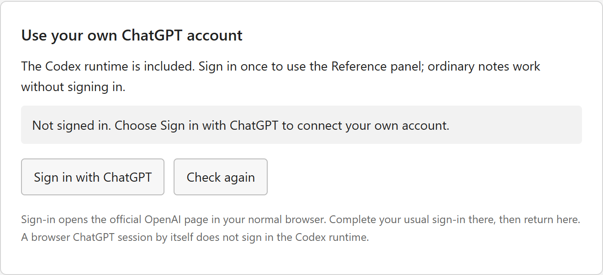
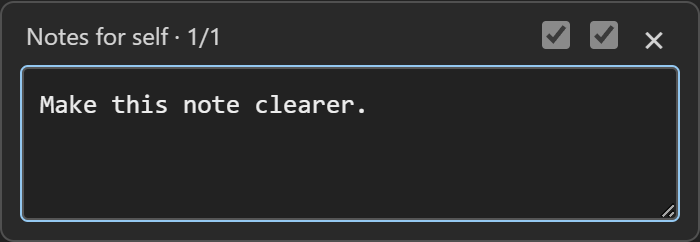

# Set up Notes Workspace 5.3.4

A Windows notepad with an optional Codex sidebar and a small **Notes for self** box. Ordinary notes work without signing in. For AI, each person connects **their own ChatGPT account**; no account, subscription, chat history or credentials are shared with the download.

This is the illustrated setup guide. The release also includes an offline copy named `SETUP.html`. The pictures below use a signed-out account page and made-up note text.

## 1. Install the Windows app

1. Download the Windows x64 ZIP from [the latest release](https://github.com/Bromlj/notes-wink-/releases/latest).
2. In File Explorer, right-click the ZIP and choose **Extract All**. Extract the **whole ZIP**, rather than opening the EXE from inside it.
3. Open the extracted **Notes Workspace** folder and double-click **Install.cmd**.
4. Open the **Notes Workspace** desktop shortcut with the blue notepad icon. You can start typing ordinary notes immediately.

The installer installs for your Windows account. You do not need to install Python, Node, an Edge extension or a development environment, and you do not need an API key. Keep the application files, DLLs and `resources` folder together if you run the extracted EXE directly.

## 2. Connect your own account

1. Press **Alt+W** to open the full **Reference** sidebar in the notepad window.
2. Choose **Options → Account → Sign in with ChatGPT**.
3. Complete the official OpenAI sign-in in your browser using **your own account** and usual sign-in method.
4. Return to Notes Workspace. Check the Account page again, then choose **Options → Reconnect** in the sidebar.
5. Select an available model and thinking level. Send a short question such as “Say hello” and check that an answer appears.

*Example: a signed-out Account page. This picture contains no real account details.*

An existing Codex sign-in for your Windows user may already be available. **Being signed in to the ChatGPT website alone does not sign in the app's Codex runtime.** The app uses your account's available Codex access and usage allowance. It does not reproduce the ChatGPT website or import its conversations.

For commands and project work, check **Windows project tools** on the Account page. If setup is needed, choose **Set up Windows sandbox** and complete the official Windows administrator prompt. Codex's normal workspace restrictions and approval controls remain enabled.

## 3. Learn the two views

**Alt+W opens the full Reference sidebar.** It has named model and thinking menus, attachments, project controls, activity and approval requests. Your messages and Codex replies use different colours and role labels. **Edit this note** lets a sidebar request revise the current real note file, with visible progress and Undo.

**Alt+S opens Notes for self.** It contains a text area, two small unlabeled checkboxes and a close button. Enter sends your request and closes the box; Shift+Enter adds a line. The two checkboxes are explained here so they do not need visible labels in the box.

*Example text only. The left checkbox permits note editing; the right checkbox enables automatic application of completed note revisions. Both start off for a new note.*

| Compact checkbox, left to right | Off | On before sending |
| --- | --- | --- |
| **First: edit this note** | The current note is not automatically sent to the request. Receive an ordinary reply. | The request can read and revise the current real note file using Codex's file tools. |
| **Second: automatically add changes** | A completed note revision waits for **Alt+I**. | A completed, permitted note revision appears automatically while compact mode is unlocked, if your note and file still match the original baseline. |

The second checkbox is available after the first is on. **The first checkbox and the full sidebar's Edit this note are the same setting** and always agree. The second controls completed compact revisions only. Permissions apply to the next request and cannot be added to a task already running. Each **+** note has a separate chat and starts with both settings off. Turning note editing off also prevents automatic compact application.

With editing off, asking to write a note returns the note content for **Alt+I** to insert. Progress messages and skill announcements stay in Reference. Adding or saving a note defaults to this local notepad; specify a cloud Page or another destination explicitly if that is what you want. Old replies saved before final-answer separation remain readable in Reference; resend them to generate a clean insertable answer.

Automatic application is for **completed note revisions**, not streaming text or ordinary chat replies. It never accepts command, file-access or other approvals. If you disable it after a task finishes, its staged revision is retained for manual insertion. Enabling it afterward cannot add automatic consent to an older request.

## 4. Use the shortcuts and status dot

| Shortcut | Action |
| --- | --- |
| **Alt+S** | Open or close Notes for self. |
| **Enter** in that box | Send and close the box. |
| **Shift+Enter** | Add a line to the question. |
| **Alt+W** | Open the full Reference sidebar. |
| **Alt+M** | Select the next model in either unlocked AI view. Use the sidebar's **Options** button for connection settings. |
| **Alt+Q** | Immediately hide the sidebar, compact box and status dot; freeze visible AI note changes. Repeated presses stay hidden. |
| **Alt+I** | Append a completed compact reply once, or apply its permitted note revision once. No sidebar is needed. |
| **Alt+1–6** | Select thinking level 1–6, as shown below. |
| **Alt+- / Alt+=** | Previous / next model from your account's catalog. |
| **Alt+Shift+S** | Open app settings, including the optional restore passphrase. |

Thinking levels are **1 Low · 2 Medium · 3 High · 4 Extra high · 5 Maximum · 6 Ultra**. Unsupported levels leave the selection unchanged. Choose Low for simple requests when supported; higher levels can take longer.

The compact title shows **model position / thinking level**. For example, **Notes for self · 3/2** means model number 3 and Medium thinking. Model positions follow your account's current catalog; use **Alt+W → Options** to see their actual names. Level 0 means a catalog default outside the six mapped levels.

Model and thinking shortcuts work in either unlocked view, keep both displays synchronized, and apply to the next request. **Alt+, / Alt+.** also select the previous / next model; **Alt+Shift+M** selects the next model.

The small dot is in the **bottom status bar, immediately after Plain text**:

| Indicator | Meaning and next step |
| --- | --- |
| **Grey** | The request is working. |
| **Green, Ready** | A completed reply or note revision is waiting. Press **Alt+I** to insert or apply it. |
| **Green, Done** | A brief completion pulse, lasting about four seconds, after automatic application, including an opted-in automatic task that made no note change. |
| **Amber** | An error, conflict or approval needs attention. Use **Alt+W** to read the details. |

A Ready indicator remains until its result is consumed or replaced by later work; the Done pulse is temporary. An automatic request that made no note change is still reported as done rather than appearing to stay working.

**Alt+Q hides the dot too.** After hiding, press **Alt+S** to return to compact mode. With automatic application enabled for that accepted request, a hidden completed note revision waits until this unlocked return before appearing. A restore passphrase applies to compact mode as well as the sidebar. Shortcuts work while this app has focus; native Windows dialogs can take priority.

## 5. Try three compact workflows

### Receive a reply without sending the note

1. Press **Alt+S** and leave the first checkbox off.
2. Type a question and press Enter.
3. Wait for the green Ready dot. Press **Alt+I** when you want the reply appended to the note.
4. Use ordinary **Ctrl+Z** to undo the insertion.

### Revise the note, then apply it yourself

1. Write a short practice note. Open **Alt+S**.
2. Check the **first** box and leave the **second** off.
3. Ask “Make this note clearer” and press Enter.
4. The actual file can be edited in the background, but the displayed note stays unchanged.
5. When the dot is green, press **Alt+I** to apply the exact completed revision, with Undo. It applies the revised note rather than appending the assistant's completion message.

### Let a completed revision appear automatically

1. Open **Alt+S** and check **both** boxes before sending.
2. Ask for a change and press Enter. While work is in progress, the displayed note stays unchanged.
3. On completion, the revision appears automatically if compact mode remains unlocked and there is no newer local or disk change. A green Done pulse confirms completion.
4. If you press **Alt+Q** during the task, the screen and indicator stay frozen. Accepted work continues; press **Alt+S** when you want to return and let the completed revision appear.

Manual edits, changed formatting, a relinked file or newer disk content prevent a conflicting automatic replacement. The pending revision is kept for review in the full sidebar. Automatic insertion does not override these checks.

## 6. Work with real files and projects

- Use **File → Open**, **Save** and **Save as** for UTF-8 text files. Open binds the real file; Save updates that file. Untitled notes get a persistent file in the app's local data folder.
- Click **+** for another note and independent Codex conversation.
- In the Reference sidebar, choose **Browse** to select a project folder. Codex can read, edit, create and move the project's actual files and run commands under its normal permissions.
- Project files save directly as Codex works. **Alt+I is for the displayed note or compact reply; project changes do not wait for it.**
- Attach supported documents or images in the sidebar, or drag them onto it.
- **Undo AI edit** in the sidebar restores an accepted note revision after its task finishes, if the note and file have not changed again. Compact replies and revisions also support ordinary Undo.

Hiding freezes visible AI changes, **not disk or project work**. Another program opening the real file can see accepted disk changes while this window is hidden. Closing the entire app can interrupt a task; using Alt+Q does not cancel it. To stop accepted work, use Stop in the sidebar.

## 7. Keep your own data private

Notes and conversations are saved locally under `%LOCALAPPDATA%\NotesWorkspace\DesktopData`. Codex manages authentication in its own user storage. Requests and attachments you submit use your own account.

**Share the original release ZIP or repository link. Do not share your app-data folder, Codex home, exported backups or test profiles.** Backups can contain note text and conversations. The [privacy guide](PRIVACY.md) explains what the public release contains.

The compact interface provides visual discretion. It does not hide processes, screen recording, sign-in pages or system inspection. Notes and backups are not encrypted. The optional restore passphrase prevents accidental reveals; it does not secure an unlocked computer.

## Troubleshooting

| What you see | What to do |
| --- | --- |
| No reply, an amber dot or an approval request | Open **Alt+W** and read the status. Respond to the actual approval if appropriate. The app never accepts it automatically. |
| Signed in to ChatGPT in a browser, but the app is signed out | Complete **Options → Account → Sign in with ChatGPT** for Codex, then **Reconnect**. |
| No models or unsupported thinking level | Reconnect after sign-in. Available choices depend on your account and selected model. |
| Asked to change the note, but only received a reply | Enable the first compact checkbox **before** sending a new edit request. An already running request cannot gain note permission retrospectively. |
| A green Ready dot but no note change | Use **Alt+I**, or enable the second checkbox before your next note-edit request if you want automatic application. |
| Task finished but the note is unchanged | Open the sidebar to read the outcome. The task may have made no file change; a conflicting revision may need review. |
| Pending or conflicting revision | Review it in the sidebar. Your newer local text is retained. Use Apply or Discard deliberately; do not overwrite a file conflict blindly. |
| File moved or changed elsewhere | Use **Relink moved file** or **Reload from disk**, as appropriate. Local recovery text is retained. |
| Blank or old desktop icon | Use **Alt+Shift+S → Desktop program → Create desktop shortcut**. If an old taskbar shortcut was pinned, unpin it and pin the recreated shortcut. |

Independent personal-use software, not affiliated with Microsoft or OpenAI.
